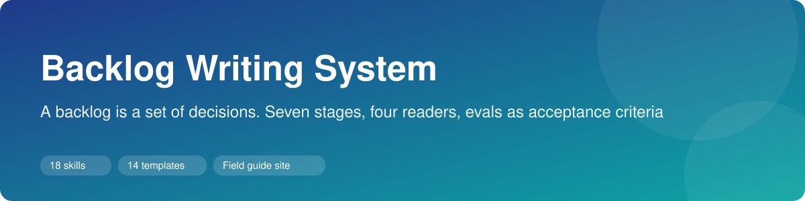
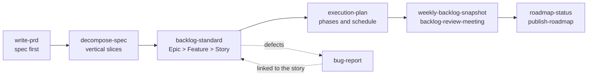

# Backlog Writing System

A complete method for writing a product backlog that developers understand on the first read and a product manager can explain without opening the spec. It covers the full path: spec, decomposition, Epic, Feature and User Story, bugs, and the weekly cadence that keeps the backlog honest.

Everything is written as reusable skills for AI coding assistants (each skill is a `SKILL.md` folder) and as plain Markdown you can read or copy. All examples use a fictional product, **Acme Field Sales Assistant**, an AI agent that drafts follow-up emails and updates the CRM after customer meetings. No real customers, data or systems appear here.

## The flow



## Skills

**Write the items**

| Skill | What it does |
|---|---|
| [`backlog-standard`](skills/backlog-standard/SKILL.md) | The standard: hierarchy, fixed parent, Story Points, Predecessor/Successor, Definition of Ready and Done |
| [`epic-feature-story-templates`](skills/epic-feature-story-templates/SKILL.md) | Epic (11 sections), Feature (15), User Story (9), and what each section must contain |
| [`why-it-exists`](skills/why-it-exists/SKILL.md) | The "why" field: starts from the consequence of the item not existing, plain language |
| [`user-story-writing`](skills/user-story-writing/SKILL.md) | Seven writing rules so a story needs no rules inside rules |
| [`work-item-card`](skills/work-item-card/SKILL.md) | A five-second card for a task or follow-up |

**Plan and decompose**

| Skill | What it does |
|---|---|
| [`write-prd`](skills/write-prd/SKILL.md) | Spec before any card or code, in gated phases |
| [`decompose-spec`](skills/decompose-spec/SKILL.md) | Vertical slices with acceptance, verification, dependency and size |
| [`execution-plan`](skills/execution-plan/SKILL.md) | Spec to ready-to-load items, phases and a schedule derived from dependencies |
| [`bug-report`](skills/bug-report/SKILL.md) | Lean bug cards that describe what happened and never assert a cause |

**Run the cadence**

| Skill | What it does |
|---|---|
| [`sprint-planning`](skills/sprint-planning/SKILL.md) | Planning layer: owner, points and sprint |
| [`weekly-backlog-snapshot`](skills/weekly-backlog-snapshot/SKILL.md) | A living document plus a frozen weekly snapshot with deltas |
| [`backlog-review-meeting`](skills/backlog-review-meeting/SKILL.md) | The weekly sponsor review, with two mandatory anchors |
| [`roadmap-status`](skills/roadmap-status/SKILL.md) | Roadmap at the depth requested, from executive view to drill-down |
| [`publish-roadmap`](skills/publish-roadmap/SKILL.md) | Stakeholder formats from one source, versioned |

## See it work

Start with [`examples/before-after.md`](examples/before-after.md): three weak backlog items rewritten to the standard, with a table of what changed. Then follow the same fictional product end to end in [`examples/acme-sales-assistant/`](examples/acme-sales-assistant): PRD, decomposition, Epic, Feature, two User Stories, a bug report, an execution plan, a weekly snapshot, a review outline and a roadmap status.

## Folders

```
skills/       14 skills, one folder each (SKILL.md)
templates/    10 fill-in templates
examples/     the Acme example, end to end
docs/         diagrams: hierarchy, delivery flow, operating cadence
```

## Use

Copy a folder from `skills/` into your assistant's skills directory, or read and adapt the Markdown directly. Replace "your tracker" with Jira, Azure DevOps, Linear or whatever you use.

## License

MIT. See [LICENSE](LICENSE).
