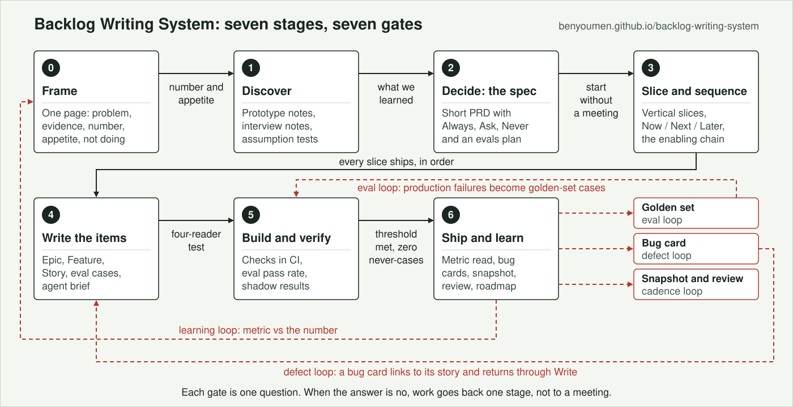

# Backlog Writing System

[](https://benyoumen.github.io/backlog-writing-system/)
[](https://benyoumen.github.io/backlog-writing-system/capacity.html)
[](https://benyoumen.github.io/backlog-writing-system/spec-preview.html)
[](https://benyoumen.github.io/backlog-writing-system/backlog-document.html)
[](#skills)
[](LICENSE)

**A backlog is a set of decisions, and the order of those decisions is what lets a team find its pace.** Finding the real problem is half the job. The other half is cutting the work so that the valuable feature is not stuck behind two unglamorous ones nobody scheduled, so that something a person can use ships every week, and so that a developer, a QA, a sponsor and a coding agent can all read the plan without a meeting.

This method covers the whole path: frame the problem, prototype to learn, spec to commit, slice vertically, **prioritize with Now / Next / Later, ROI impact and the enabling chain**, simulate the sprints against the team's real capacity, render the spec as one readable page, write Epic / Feature / User Story items, turn acceptance criteria into evals when the behavior is probabilistic, brief the coding agent, and run an honest weekly cadence.

> [!TIP]
> **Three minutes:** the [field guide](https://benyoumen.github.io/backlog-writing-system/). **Five more:** move a story in the [capacity simulation](https://benyoumen.github.io/backlog-writing-system/capacity.html) and watch the landing date change, then open the [spec preview](https://benyoumen.github.io/backlog-writing-system/spec-preview.html) a sponsor can read. **Then use it:** copy any folder from [`skills/`](skills) into your assistant's skills directory.

## Prioritize what makes it live

Three questions of every Feature, not one:

1. **How much does it move the number?** The ROI impact: effect on the Epic's metric, reach, confidence, against effort. No estimate, no rank.
2. **When?** Now, Next or Later. Bands, not dates. Dates are derived from capacity and dependencies, never typed into a card.
3. **What has to exist first?** The enabling chain. A Now Feature pulls its prerequisites into Now with an explicit inherited priority, even when they score low on their own. The go-live set, in dependency order, is wave 1, and every week has something demonstrable.

The third question is the one teams skip, and the one that decides the pace. The full method, with the worked example and the rules of the chain: [`docs/prioritization.md`](docs/prioritization.md).

From the same inputs come two tools: a **live capacity simulation** (the team by name, weekly capacity in Fibonacci points, the stories with their relations, the week each Feature and the Epic land, recomputed when you move anything) and a **readable spec preview** (one plain sentence per item next to its numbered sections, a glossary, phases, and a schedule chart). The simulation is the conversation with the sponsor; the tracker is the record.

## Review the whole backlog before it reaches the tracker

A tracker board is compact: one card at a time, without the why, the waves or the capacity in view. So the review happens in a **generated backlog document** instead, and the tracker is loaded only afterwards. The document reads top to bottom: summary, the tree of Epics and Features, the sprints, the waves of delivery, then every Epic, Feature and User Story with its plain sentence and its sections. Its planning layer runs the sprint planning inside the document: each Feature opens a pop-up where stories get an owner and Fibonacci points, and a bar at the bottom shows, live, the points per person against their capacity and the team total against the sprint limit, turning amber near the limit and red above it, with a toast the moment someone is over. In the original, that chapter writes owner, points and sprint to Azure DevOps from the browser; the public version exports the plan.

Open the example: [the backlog document](https://benyoumen.github.io/backlog-writing-system/backlog-document.html), a fictional real-estate program with five Epics, fourteen Features, about forty stories, four waves and a team of five. Generated from one JSON by `tools/backlog_document/build.py`, like everything else here: the document is never edited by hand.

## Start here

| If you | Read | Then use |
|---|---|---|
| Decide what gets built first | [`docs/prioritization.md`](docs/prioritization.md) | [`prioritize-now-next-later`](skills/prioritize-now-next-later/SKILL.md), [`capacity-simulation`](skills/capacity-simulation/SKILL.md) |
| Write backlog items every week | [`examples/before-after.md`](examples/before-after.md), three weak items rewritten | [`backlog-standard`](skills/backlog-standard/SKILL.md), [`why-it-exists`](skills/why-it-exists/SKILL.md), [`user-story-writing`](skills/user-story-writing/SKILL.md) |
| Hand a plan to a tech lead, a QA or a sponsor | the [spec preview](https://benyoumen.github.io/backlog-writing-system/spec-preview.html) | [`spec-preview-html`](skills/spec-preview-html/SKILL.md), [`execution-plan`](skills/execution-plan/SKILL.md) |
| Lead a team and own outcomes | [`docs/workflow.md`](docs/workflow.md), seven stages and seven gates | [`frame-the-problem`](skills/frame-the-problem/SKILL.md), [`write-prd`](skills/write-prd/SKILL.md), [`backlog-review-meeting`](skills/backlog-review-meeting/SKILL.md) |
| Ship AI features or build with coding agents | [`docs/principles.md`](docs/principles.md), principles 7, 8 and 11 | [`eval-cases`](skills/eval-cases/SKILL.md), [`agent-brief`](skills/agent-brief/SKILL.md), [`AGENTS.md`](AGENTS.md) |

## The workflow



Each gate is one question. When the answer is no, the work goes back one stage, not to a meeting.

| Stage | Gate question | Skills |
|---|---|---|
| 0 Frame | Can we say the number and the appetite in one sentence? | `frame-the-problem` |
| 1 Discover | What did we learn that changes the spec? | `prototype-to-spec` |
| 2 Decide | Could an engineer and a coding agent start without a meeting? | `write-prd` |
| 3 Slice and sequence | Does every slice ship behavior, in an order that lets the team find its pace? | `decompose-spec`, `prioritize-now-next-later`, `execution-plan`, `capacity-simulation` |
| 4 Write | Does each item pass the four-reader test? | `backlog-standard`, `epic-feature-story-templates`, `why-it-exists`, `user-story-writing`, `eval-cases`, `agent-brief`, `spec-preview-html` |
| 5 Build and verify | Threshold met on the held-out set, and zero never-cases? | `sprint-planning`, `capacity-simulation`, `eval-cases` |
| 6 Ship and learn | Did the number move? What do we delete? | `weekly-backlog-snapshot`, `backlog-review-meeting`, `roadmap-status`, `publish-roadmap`, `bug-report` |

Full detail, the loops, and what changed at each stage in 2026: [`docs/workflow.md`](docs/workflow.md).

## What is different about this method

- **Sequence by the chain, not by the score.** Now / Next / Later with ROI impact, then the prerequisites pulled into Now with inherited priority. The valuable feature ships because the two boring ones were built first, on purpose.
- **Readable for everyone.** Every item carries a plain sentence next to its sections, every term is in the glossary, and the plan is rendered as one page. A developer starts, a QA tests, a sponsor knows what lands when.
- **Capacity you can touch.** Fibonacci points, named developers, weekly capacity, a reserve for enabling work, a feature never split across sprints. Move a story and the Epic's date moves.
- **Evals as acceptance criteria.** For probabilistic behavior, acceptance is a threshold on a distribution: a golden set from real inputs, a scoring method, a pass rate agreed before the build, never-cases. An AI item without eval cases is not Ready.
- **Autonomy is earned.** Every spec states Always / Ask first / Never. The ladder from observing to acting alone lives in the companion [agent-design-principles](https://github.com/Benyoumen/agent-design-principles).
- **Written for agents too.** [`AGENTS.md`](AGENTS.md) tells a coding agent how to compose these skills, what it must never invent, and how to verify before returning.
- **Honest cadence.** Weekly snapshot with a cutoff and a "removed this week" section, a review that opens with last week's commitments, a roadmap that carries its photo date.

## Skills

Each skill is a folder with a `SKILL.md`: when to use, inputs, procedure, rules, checklist, a weak and a corrected example, definition of done. They work with Claude Code, Codex, Cursor and similar agents, and read fine as plain Markdown.

**Frame and decide**

| Skill | What it does |
|---|---|
| [`frame-the-problem`](skills/frame-the-problem/SKILL.md) | One page before any design tool: problem, who, evidence, the number, the appetite, not-doing |
| [`prototype-to-spec`](skills/prototype-to-spec/SKILL.md) | What a prototype settles, what it cannot, and the questions to answer before a ticket exists |
| [`write-prd`](skills/write-prd/SKILL.md) | A short spec in gated phases: goal with a number, boundaries Always / Ask first / Never, evals plan |

**Slice, prioritize and plan**

| Skill | What it does |
|---|---|
| [`decompose-spec`](skills/decompose-spec/SKILL.md) | Vertical slices with acceptance, verification, dependency and size; appetite before estimate |
| [`prioritize-now-next-later`](skills/prioritize-now-next-later/SKILL.md) | Now / Next / Later, the ROI impact score, the enabling chain and the go-live set |
| [`execution-plan`](skills/execution-plan/SKILL.md) | Spec to ready-to-load items, waves and a schedule derived from dependencies |
| [`capacity-simulation`](skills/capacity-simulation/SKILL.md) | The live sprint simulation: named people, weekly capacity, Fibonacci points, landing dates, what-ifs |

**Write the items**

| Skill | What it does |
|---|---|
| [`backlog-standard`](skills/backlog-standard/SKILL.md) | The standard: hierarchy, one fixed parent, Story Points, Predecessor / Successor, Definition of Ready and Done |
| [`epic-feature-story-templates`](skills/epic-feature-story-templates/SKILL.md) | Epic (11 sections), Feature (15), User Story (9), and what each section must contain |
| [`why-it-exists`](skills/why-it-exists/SKILL.md) | The why, written from the consequence of absence |
| [`user-story-writing`](skills/user-story-writing/SKILL.md) | Seven writing rules so a story needs no rules inside rules |
| [`spec-preview-html`](skills/spec-preview-html/SKILL.md) | The spec as one readable page: plain sentence, sections, glossary, phases, schedule; generated, never hand-edited |
| [`eval-cases`](skills/eval-cases/SKILL.md) | Acceptance criteria for AI behavior: golden set, scoring, threshold, never-cases |
| [`agent-brief`](skills/agent-brief/SKILL.md) | A story prepared for a coding agent: why, verifiable checks, verification command, Never list |
| [`bug-report`](skills/bug-report/SKILL.md) | Lean bug cards that describe what happened and never assert a cause |
| [`work-item-card`](skills/work-item-card/SKILL.md) | A five-second card for a task or follow-up |

**Run the cadence**

| Skill | What it does |
|---|---|
| [`sprint-planning`](skills/sprint-planning/SKILL.md) | Planning layer: owner, points and sprint, written back to the tracker |
| [`weekly-backlog-snapshot`](skills/weekly-backlog-snapshot/SKILL.md) | A living document plus a frozen weekly snapshot with deltas, including what was removed |
| [`backlog-review-meeting`](skills/backlog-review-meeting/SKILL.md) | The weekly sponsor review, with two mandatory anchors and a line for what was cut |
| [`roadmap-status`](skills/roadmap-status/SKILL.md) | The roadmap at the depth requested, from executive view to drill-down |
| [`publish-roadmap`](skills/publish-roadmap/SKILL.md) | Stakeholder formats from one source, versioned with a photo date |

## See it work

One fictional product, **Acme Field Sales Assistant** (an AI agent that drafts follow-up emails and updates the CRM after customer meetings), runs through every stage in [`examples/acme-sales-assistant/`](examples/acme-sales-assistant): frame, prototype notes, PRD, decomposition, the Now / Next / Later board with its chain, execution plan, capacity plan, Epic, Feature, two User Stories, eval cases, an agent brief, a bug report, a weekly snapshot, a review outline and a roadmap status. All names, numbers and dates are fictional.

Start with [`examples/before-after.md`](examples/before-after.md): three weak backlog items rewritten to the standard, with a table of what changed.

## The twelve principles

Start from the number. Prototype to learn, spec to commit. Write the why from the consequence of absence. Pass the four-reader test. Sequence by the chain, not by the score. Structure serves navigation, not ceremony. For AI behavior, the acceptance criterion is an eval. Autonomy is earned, tier by tier. Bugs describe, they do not diagnose. A roadmap is a dated photo, not a promise. Write for the agent in the room. Volume is not progress: delete nine.

Each one with the failure it prevents, where it lives in the method, and who is making the same argument now: [`docs/principles.md`](docs/principles.md). The argument behind them: [`docs/manifesto.md`](docs/manifesto.md).

## Use

```
skills/       21 skills, one folder each (SKILL.md)
templates/    17 fill-in templates
examples/     the Acme example, end to end, plus before-and-after rewrites
docs/         manifesto, principles, prioritization, workflow, hierarchy, delivery flow, cadence
site/         the field guide, the capacity simulation and the spec preview, published with GitHub Pages
tools/        the generator behind the spec preview (Python, standard library only)
AGENTS.md     standing instructions for a coding agent using this repository
```

- **Claude Code:** copy a skill folder into `.claude/skills/` (project) or `~/.claude/skills/` (personal). The skill is then invoked by name.
- **Codex, Cursor and others:** point your `AGENTS.md` at the skill files you use, or paste a `SKILL.md` into the task.
- **People:** read the Markdown. Replace "your tracker" with Jira, Azure DevOps, Linear or whatever you use.

## Sources

The method takes its arguments from current practitioners, not its numbers: Cagan on the AI productivity paradox, Torres on evals as the product team's job, Pollick on acceptance as a threshold on a distribution, the Now / Next / Later roadmap, Shape Up on appetite, Linear on plain issues, the spec-driven development tooling that reads `AGENTS.md`. The full list with links is at the end of [`docs/principles.md`](docs/principles.md#sources).

## License

MIT. See [LICENSE](LICENSE).
