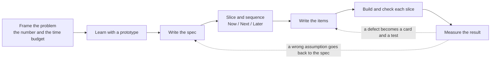

# Delivery flow

How the process skills connect, from an idea to a closed bug.

*Seven steps, each ending with a review by the product manager before the next starts. Two loops: a defect found in use becomes a card linked to the story it broke, and a test before it becomes a fix; a defect that shows the spec was wrong goes back to the spec, not straight to a fix. The success criterion is read against the spec when the last phase ships.*

Inside the spec step, a request that bundles several separately testable capabilities gets a capability map first, reviewed before anything is specified. Inside the sequence step, the Now / Next / Later board pulls each valuable Feature's prerequisites into Now and sets the order; the capacity simulation turns that order into landing weeks once the team is known.

## Where each artifact lives

| Artifact | Owner | Rule |
|---|---|---|
| Frame | `frame-the-problem` | The number and the appetite, decided before any estimate |
| Prototype notes | `prototype-to-spec` | A prototype's assumptions are not requirements until the spec says so |
| Spec | `write-prd` | One owner per fact, updated the day a decision changes |
| Plan with the dependency graph | `decompose-spec` | Holds an index of card ids, never a second task list |
| Now / Next / Later board | `prioritize-now-next-later` | Three questions per Feature; a Now Feature pulls its chain into Now; items move only at the weekly review, with a reason |
| Capacity plan | `capacity-simulation` | The simulation is the conversation, the tracker is the record; only the start date is typed |
| Execution plan | `execution-plan` | Only the start date is typed, every other date is derived |
| Readable spec page | `spec-preview-html` | One plain sentence per item, every term in the glossary, generated and never hand-edited |
| Cards | `backlog-standard` | The tracker is the list of record |
| Eval cases | `eval-cases` | A threshold on a distribution; a production failure becomes a case before a fix |
| Agent brief | `agent-brief` | Checks, commands, Never list; standing conventions live in `AGENTS.md` |
| Bugs | `bug-report` | Describe, never assert a cause |

## Feedback loops

- A changed decision goes back to the spec the same day, then the plan is re-derived.
- A bug that shows the spec was wrong returns to Specify, not straight to a fix.
- Closed items feed the time measurement used by `decompose-spec`. With fewer than 8 comparable items, a duration stays `declared`.
- A production failure of a probabilistic behavior becomes an eval case before it becomes a fix. The threshold is renegotiated only with the evidence on the table.

## Worked example

The files in `examples/acme-sales-assistant/` follow this flow end to end: `frame.md`, then `prototype-notes.md`, then `prd.md`, `decomposition.md`, `prioritization.md` and `execution-plan.md`, then the items (`epic.md`, `feature.md`, `user-story-1.md`, `user-story-2.md`) with `eval-cases.md`, `agent-brief.md` and `spec-preview-notes.md`, then `capacity-plan.md` at sprint planning, then `bug-report.md` for a defect found in the pilot. The index with dates is in that folder's `README.md`.
