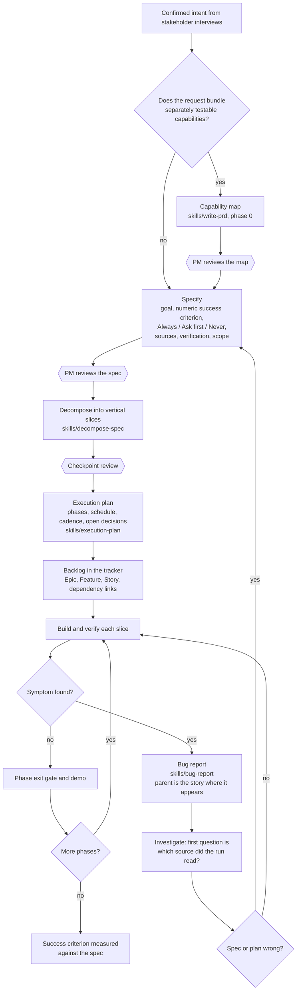

# Delivery flow

How the process skills connect, from an idea to a closed bug.

## Where each artifact lives

| Artifact | Owner | Rule |
|---|---|---|
| Spec | `write-prd` | One owner per fact, updated the day a decision changes |
| Plan with the dependency graph | `decompose-spec` | Holds an index of card ids, never a second task list |
| Execution plan | `execution-plan` | Only the start date is typed, every other date is derived |
| Cards | Your backlog standard | The tracker is the list of record |
| Bugs | `bug-report` | Describe, never assert a cause |

## Feedback loops

- A changed decision goes back to the spec the same day, then the plan is re-derived.
- A bug that shows the spec was wrong returns to Specify, not straight to a fix.
- Closed items feed the time measurement used by `decompose-spec`. With fewer than 8 comparable items, a duration stays `declared`.

## Worked example

The files in `examples/acme-sales-assistant/` follow this flow end to end: `prd.md`, then `decomposition.md`, then `execution-plan.md`, then `bug-report.md` for a defect found while US02 was being verified.
