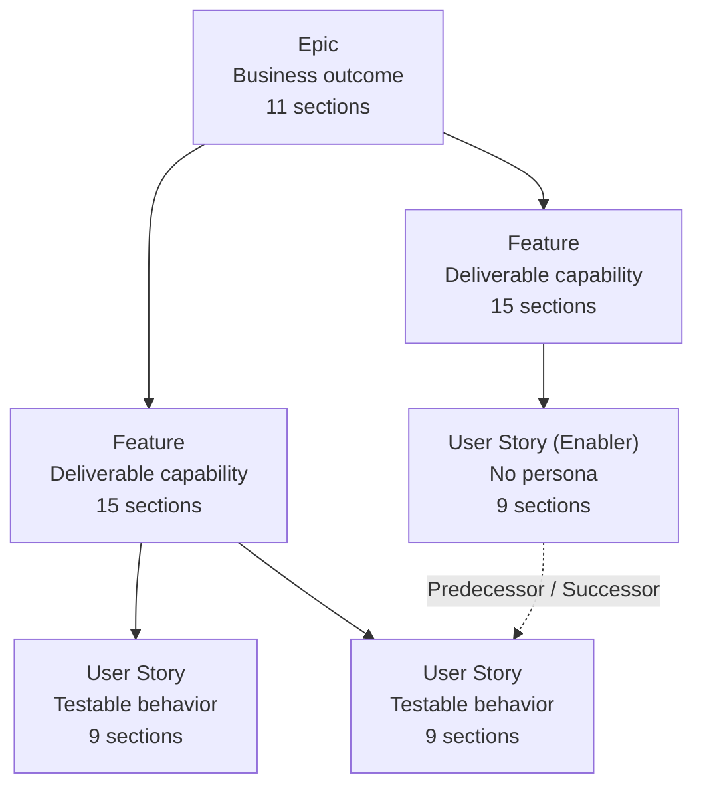
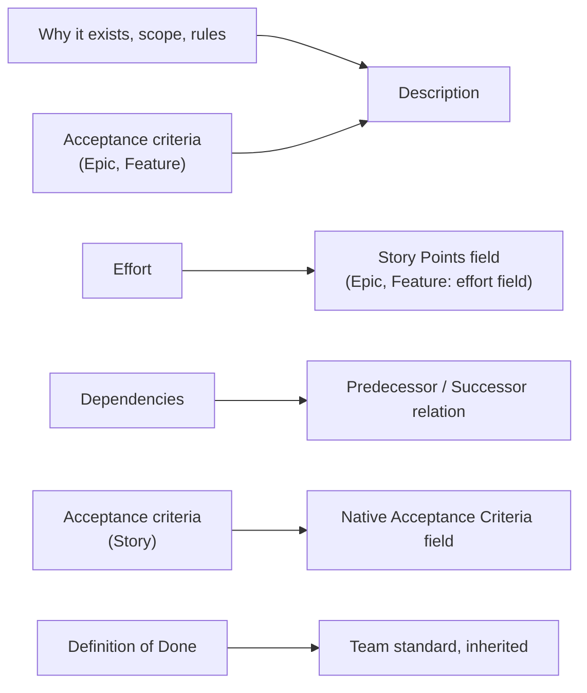
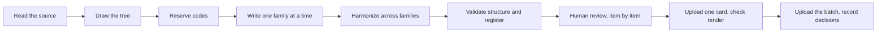

# Backlog hierarchy

A three-level backlog, with one fixed parent rule and clear places for effort, dependencies and acceptance.

## Rules the diagram shows

- A User Story is always the child of a Feature. Never of an Epic.
- Dependencies are relations (dotted line), not sentences in a description.
- A parent does not close while a child is open.

## Where each piece of information lives

## What each level answers

| Level | Question | Section "Why it exists" says |
|---|---|---|
| Epic | What changes for the business? | The business result that does not happen without this block |
| Feature | What can a person do that they could not before? | The missing capability and the manual work meanwhile |
| User Story | What exactly happens, and how do we check it? | The concrete behavior that fails without this slice |

## Flow of a new batch

