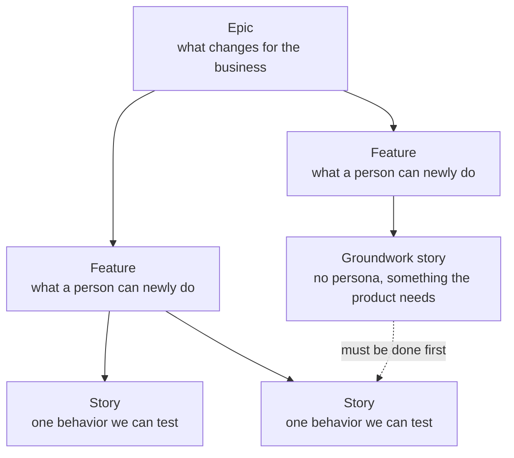
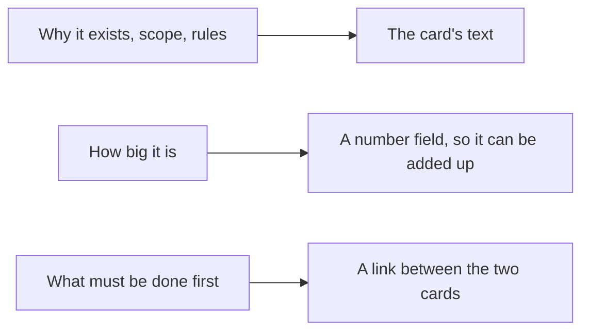
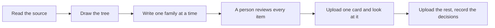

# Backlog hierarchy

A three-level backlog, with one fixed parent rule and clear places for effort, dependencies and acceptance.

*Three levels, one parent each. The dotted line is a dependency: the groundwork story must finish before the other one starts. The Epic has 11 sections, a Feature 15, a Story 9.*

## Rules the diagram shows

- A User Story is always the child of a Feature. Never of an Epic.
- Dependencies are relations (dotted line), not sentences in a description.
- A parent does not close while a child is open.
- For a probabilistic behavior, the acceptance criteria are eval cases in a linked file. No eval cases, not Ready.

## Where each piece of information lives

*Three things never live in prose: the size goes in a number field, a dependency is a link between cards, and the Definition of Done is the team's standard, inherited by every card. Acceptance criteria go in the tracker's own field on a Story and in the text on an Epic or Feature. For AI behavior, the acceptance criteria are the eval file linked from the card; for a story a coding agent builds, the brief is linked from the technical notes.*

## What each level answers

| Level | Question | Section "Why it exists" says |
|---|---|---|
| Epic | What changes for the business? | The business result that does not happen without this block |
| Feature | What can a person do that they could not before? | The missing capability and the manual work meanwhile |
| User Story | What exactly happens, and how do we check it? | The concrete behavior that fails without this slice |

## Flow of a new batch

*Nothing generated goes to the board unread. Codes are reserved before writing, vocabulary is harmonized across families, and the one card uploaded first is checked on the screen before the batch follows.*
