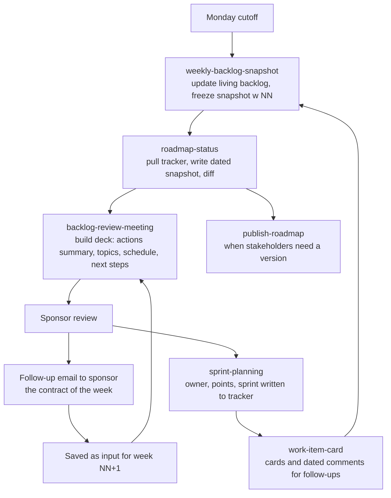

# Operating cadence

How the operations skills fit into one week. The goal is that the sponsor review, the snapshot, the roadmap and the tracker always tell the same story.

## Weekly rhythm

| Step | Skill | Input | Output |
|---|---|---|---|
| 1 | `weekly-backlog-snapshot` | Living backlog, feedback, KPI values | Updated living document and snapshot w NN |
| 2 | `roadmap-status` | Tracker, registry | Dated snapshot, diff, optional delay events |
| 3 | `backlog-review-meeting` | Last week's deck, sponsor email, meeting notes, snapshot, roadmap | Review deck and PDF for week NN |
| 4 | Meeting | Deck | Decisions and commitments |
| 5 | Follow-up email | Meeting | Input file for week NN+1 |
| 6 | `sprint-planning` | Backlog, team calendar | Owners, points and sprint in the tracker |
| 7 | `work-item-card` | Commitments | Cards with next step and dated comments |
| As needed | `publish-roadmap` | Roadmap source | Document, deck, PDF, PPTX, diff |

## Consistency rules across the cadence

- One source per fact. The tracker owns state. The backlog owns scope. The registry owns the roadmap mapping.
- A shared fact changes everywhere in the same pass.
- The previous week's folder and snapshots are never edited. Corrections go into the living document and show up in the next snapshot.
- The follow-up email wins over memory when they disagree.
- Names of people stay out of sponsor-facing material. Sources of feedback are anonymous.
