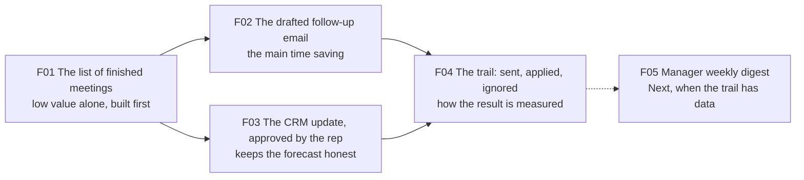

# Prioritization: Now / Next / Later, ROI impact, and the enabling chain

Finding the real problem is half the job. The other half is cutting the work in the order that lets a team find its pace: no waiting on foundations that nobody scheduled, no half-built features that cannot ship, something a person can use every week. This page is the method for that second half.

## Three questions, not one

Most prioritization stops at "how valuable is this?". That question alone produces a list where the most valuable feature sits at the top and cannot be built, because two unglamorous things it depends on sit at the bottom. The method asks three questions of every Feature:

1. **How much does it move the number?** The ROI impact: the effect on the Epic's outcome metric, for how many people, with what confidence, against what effort.
2. **When?** Now, Next or Later. A commitment band, not a date.
3. **What has to exist first?** The enabling chain: the features, enablers and tasks that carry little value on their own and without which the valuable feature never goes live.

The third question is the one teams skip, and it is the one that decides the pace.

## 1. The ROI impact score

A sorting aid, not a truth. Score each Feature against the Epic's number:

| Factor | Scale | Question |
|---|---|---|
| Impact | 3 high, 2 medium, 1 low | If this ships, how far does the Epic's number move? |
| Reach | share of the people or volume affected, 0 to 1 | Who gets the effect, how often? |
| Confidence | 3 measured, 2 estimated, 1 guessed | What evidence sits behind the two numbers above? |
| Effort | Story Points of its stories, or days | What does it cost, from the people who will build it? |

ROI impact = (Impact × Reach × Confidence) ÷ Effort. Two rules keep it honest:

- **No estimate, no rank.** A Feature without estimated User Stories does not get a score. It goes to "to refine" and stays out of the calendar until someone has broken it down. Scheduling what nobody has cut is a promise to the sponsor and a surprise to the team.
- **Impact means the Epic's number.** Accuracy, latency, tokens and cost are not impact. They are technical criteria and belong in the Feature's non-functional section.

The score orders candidates. It does not place them. Placement is the next two questions.

## 2. Now / Next / Later

Three bands, no dates inside them. Dates are derived later from capacity and dependencies, never typed into a card.

| Band | Meaning | What it commits |
|---|---|---|
| **Now** | The current delivery cycle. Features here are fully decomposed, estimated and dependency-complete. | A demonstrable result at the end of the cycle |
| **Next** | After Now. Likely, scoped, not yet estimated to the story. | A direction, reviewed weekly, moved up only when its chain is ready |
| **Later** | Ideas with a written reason to exist. No scope, no estimate. | Nothing. A place to park without losing the why |

A Feature moves between bands only in the weekly review, with the reason recorded. "Removed" is a fourth state and it is reported, so the backlog shows what it deleted as well as what it added.

## 3. The enabling chain

Here is the part that makes the method work. Take the highest-ROI Feature placed in Now. List what has to exist before a person can use it in production: a data feed, a permission model, a write path to the system of record, an approval screen. Most of these score low on their own. Nobody asks for "meeting notes ingestion". Everyone asks for "the draft email after the meeting", and it cannot exist without the ingestion.

The rule: **a Now Feature pulls its whole chain into Now, and the pulled items carry an explicit inherited priority** ("Now, enabling F1"). Inherited priority is visible on the card and in the board, so nobody later asks why a low-impact feature is being built first.

*Read it from the right: the value sits in the draft and the CRM update. Neither exists without the meeting list, so the meeting list goes first.*

F02 and F03 carry the value. F01 carries almost none on its own, and nothing ships without it. So wave 1 is F01, then F02 and F03 in parallel, then F04, and F01 is built first although the score alone would put it fourth on the board.

Rules of the chain:

- **A dependency is a relation on the card, never a sentence in a description.** Sentences do not sort.
- **A dependency never points to a later band or a later wave.** If it does, either the dependency moves up or the dependent moves down. The generator refuses the plan otherwise.
- **No cycles.** A cycle is two items each waiting for the other; the plan has a hole.
- **Reduce the chain.** If A depends on B and B on C, do not also draw A to C. The implied edge makes the card look more blocked than it is.
- **The go-live set of an Epic is the smallest set of Features that makes its first valuable outcome usable in production.** That set, in dependency order, is wave 1. It is what the sponsor is promised; everything else is Next.

## 4. Waves, and something demonstrable every week

Now is cut into waves. A wave ends with something a person uses, a short validation with real users, and a production release. A wave that delivers "the data layer" is not a wave; it is architecture with no exit.

From the waves and the chain, the schedule is derived: dependency order inside the wave, risk first where the order is free, a feature never split across two sprints, and a reserve of each sprint for enabling and platform work (a third is a good start) so the foundation that waits for the product to finish never has to wait. Then the weekly cadence is read off the schedule: what is demonstrable in week 1, week 2, week 3. **An empty week means the slicing is wrong**, not that the team is slow.

The same inputs feed the capacity simulation: the team by name, each person's weekly capacity in points, the stories with their Fibonacci points and relations, and the date each Feature and the Epic land. Move a story, change a person's capacity, add a developer, and the date moves. The simulation is the conversation with the sponsor; the board is the record.

## 5. Readable for everyone

The plan is rendered as a readable document, not left in the tracker. Each Epic, Feature and Story carries a one-sentence summary in plain language next to its numbered sections, a glossary defines every term that appears, and the schedule is a chart with the phases and the deliveries on it. A developer reads the sections and starts. A QA reads the acceptance cases and tests. A sponsor reads the sentence and the chart and knows what lands when, without a meeting.

## The worked example

**Epic:** customer follow-up within a day of every meeting. **Number:** meetings followed up within one working day, 80% target, baseline measured in the first two weeks of the pilot. **Appetite:** six weeks of two people. Every number is illustrative.

| Feature | Impact | Reach | Conf. | Effort (pts) | ROI | Band | Why here |
|---|---|---|---|---|---|---|---|
| F01 Meetings and notes | 1 | 1.0 | 3 | 3 | 1.00 | Now, enabling F02 and F03 | Nothing drafts and nothing previews without the list of finished meetings. Lowest value on its own, built first |
| F02 Follow-up draft and send | 3 | 0.9 | 2 | 11 | 0.49 | Now | The reason the Epic exists: the draft is the main time saving |
| F03 CRM write-back | 3 | 0.9 | 2 | 15 | 0.36 | Now | Moves the second metric directly; the write path is the autonomy contract |
| F04 Activity trail | 2 | 0.2 | 3 | 2 | 0.60 | Now | Measures the Epic's number; without it nobody can read the result |
| F05 Manager weekly digest | 2 | 0.2 | 1 | 8 | 0.05 | Next | Valuable once F04 has two weeks of data; scoped, not yet estimated to the story |
| F06 Drafts in a second language | 1 | 0.1 | 1 | 8 | 0.01 | Later | One rep in ten works in a second language; reason recorded, no scope yet |
| F07 Schedule the next meeting from the follow-up | (no stories) | | | | | To refine | Not estimated, so not ranked and not scheduled |

The score alone would put F01 fourth and F04 third. The chain puts F01 first.

Wave 1 (go-live set): F01, then F02 and F03 in parallel, then F04. Week 1 demonstrable: the list of today's finished meetings with their notes, and the CRM write path tested against a sandbox. Week 2: a drafted follow-up with the facts it used, and a CRM update preview with old and new values. Week 3: a rep sends a follow-up from their own mailbox, an approved preview writes to the CRM, and the manager sees sent, applied and ignored for the week. Week 4: pilot with twelve reps, first baseline read. F05 enters Next when the trail has two weeks of data.

With a team of four (weekly capacities 5, 5, 4 and 3 points) the ten stories of wave 1 land on day 15. The what-ifs are the lesson: a fifth person changes nothing, because nothing is unblocked for them; moving the trail into the pilot week gains two days, because it removes the last link of the chain. What sets the date is the chain, not the capacity.

The full board, the chain, the review log and the capacity plan for this example are in [`examples/acme-sales-assistant/prioritization.md`](../examples/acme-sales-assistant/prioritization.md) and [`capacity-plan.md`](../examples/acme-sales-assistant/capacity-plan.md), and the simulator is live on the field guide: [capacity simulation](https://benyoumen.github.io/backlog-writing-system/capacity.html).

## Where this sits in the workflow

Stage 3 of the [workflow](workflow.md) is "Slice and sequence". Decomposition produces the stories and their sizes; this page produces the order. The skills are [`prioritize-now-next-later`](../skills/prioritize-now-next-later/SKILL.md), [`capacity-simulation`](../skills/capacity-simulation/SKILL.md) and [`spec-preview-html`](../skills/spec-preview-html/SKILL.md).
