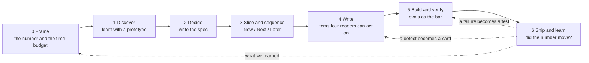

# The workflow: seven stages, seven gates

Stages are not phases of a waterfall. They are the questions a team must answer in order, and the loops that send work back. Each gate is one question. When the answer is no, the work goes back one stage, not to a meeting.

*Seven stages. Each arrow is a gate with one question. When the answer is no, the work goes back one stage, not to a meeting. The dotted lines are the loops: what was learned opens the next frame, a production failure becomes a test case before a fix, a defect becomes a card linked to the story it broke.*

## The stages at a glance

| Stage | Purpose | Artifact | Gate question | Skills |
|---|---|---|---|---|
| 0 Frame | Decide whether this is worth time at all | One-page frame: problem, who, evidence, number, appetite, not-doing | Can we say the number and the appetite in one sentence? | `frame-the-problem` |
| 1 Discover | Learn before committing | Prototype notes, interview notes, assumption tests | What did we learn that changes the spec? | `prototype-to-spec` |
| 2 Decide | Record the decision | PRD in gated phases, with boundaries and an evals plan | Could an engineer and a coding agent start without a meeting? | `write-prd` |
| 3 Slice and sequence | Make it buildable in small pieces, in the order that lets the team find its pace | Decomposition, the Now / Next / Later board, execution plan | Does every slice ship behavior, and is every Now Feature's chain in Now? | `decompose-spec`, `prioritize-now-next-later`, `execution-plan` |
| 4 Write | Put it in the tracker so four readers can act, and render it as one readable page | Epic, Feature, User Story, eval cases, agent brief, the spec preview | Does each item pass the four-reader test? | `backlog-standard`, `epic-feature-story-templates`, `why-it-exists`, `user-story-writing`, `eval-cases`, `agent-brief`, `spec-preview-html` |
| 5 Build and verify | Ship each slice to the agreed bar, on a schedule the team can see | Capacity plan; passing checks; eval pass rate; shadow results | Threshold met on the held-out set, and zero never-cases? | `capacity-simulation`, `sprint-planning`, `eval-cases` |
| 6 Ship and learn | Find out whether the number moved | Snapshot, review deck, roadmap status, bug cards | Did the number move? What do we delete? | `weekly-backlog-snapshot`, `backlog-review-meeting`, `roadmap-status`, `publish-roadmap`, `bug-report` |

## Stage by stage

### 0. Frame

One page, written before anyone opens a design tool. The problem in the words of the person who has it. Who has it and how often. The evidence you have and the evidence you lack. The outcome and the number that would prove it. The appetite: how much time this is worth, decided now, so scope bends to time later instead of the reverse. What you are not doing.

Typical failure: skipping to the solution because a model made it easy to render one. The frame is what the prototype will be judged against.

### 1. Discover

Building to learn. Prototypes, interviews, assumption tests, a throwaway agent that runs on last month's data. The point is to be wrong cheaply. Keep the notes short and dated, and separate what the prototype settled from what it could not settle: usually the edge cases, the failure modes, and the cost of being wrong in production.

Typical failure: the demo that convinces the room and skips straight to a ticket. The `prototype-to-spec` skill exists to stop that.

### 2. Decide: the spec

The PRD is short and gated. A capability map when the request has several testable capabilities. The goal and the success criterion with a number. The boundaries of autonomy for anything that acts on a person's behalf: Always, Ask first, Never. The data each capability reads and writes, and its source of truth. An evals plan for every probabilistic behavior: what the golden set will cover, how it will be scored, what threshold must be met. What is out of scope.

Typical failure: a ten-page document nobody reads, or a prototype standing in for a decision nobody made.

### 3. Slice and sequence

Vertical slices, each crossing collect, decide, show and write, each shipping behavior a person can verify. Sizes XS to L. Above L you split, you do not estimate. Dependencies are declared and the schedule is derived from them, so there is one critical path and everyone can see it.

Then the order. Every Feature answers three questions: how much it moves the number (an ROI impact score), when (Now, Next or Later), and what has to exist first (the enabling chain). A Now Feature pulls its prerequisites into Now, with their inherited priority written on the card, however low they score on their own; the go-live set, in dependency order, is wave 1. Something is demonstrable every week, or the cut is wrong. The method is in [prioritization.md](prioritization.md).

Typical failure: horizontal layers ("build the data model", "build the API") that ship nothing for weeks. Or a list ranked by value alone, where the most valuable item sits at the top and cannot start because the two things it depends on sit at the bottom.

### 4. Write the items

Epic for the outcome, Feature for the deliverable capability, User Story for the testable behavior. One fixed parent. The why written from the consequence of absence. Acceptance criteria an engineer can verify. For AI behavior, eval cases instead of deterministic criteria. For work an agent will execute, an agent brief with the verification command and the Never list. When the batch is complete, the spec preview renders it as one readable page: a plain sentence per item next to its numbered sections, a glossary, the phases and the schedule, so the tech lead, QA and the sponsor read the same thing.

Typical failure: items that only their author understands. Run the four-reader test on each one.

### 5. Build and verify

Each slice to the agreed bar, on a schedule everyone can see: the capacity simulation takes the team by name, each person's weekly capacity and the stories with their points and relations, and shows the week each slice and the Epic land, and what moves the date. Deterministic checks for the ordinary software around the model. Eval pass rate on the golden set for the probabilistic parts, in CI, before merge. Shadow mode before any agent acts on real records. Promotion up the autonomy ladder only on evidence.

Typical failure: a green pipeline and a feature that is right 92 times in 100 when the risk tier needed 99.

### 6. Ship and learn

Read the number. Feed production failures back into the golden set. File defects as descriptions, not diagnoses. Snapshot the backlog with a cutoff and show the delta, including what was removed. Review with the sponsor by reading last week's commitments first. Publish the roadmap with its photo date.

Typical failure: celebrating output. The only question that matters here is whether the number moved and what that tells the next frame.

## What changed in 2026

| Stage | Before | Now | Why |
|---|---|---|---|
| Frame | A slide with a vision | A page with a number and an appetite | Output is free; the frame is the judgment |
| Discover | Mockups, then a long PRD | Working prototypes in hours; PMs build their own | Cagan's building-to-learn; Affirm, Uber, Slack |
| Decide | The PRD as the main document | A short alignment spec plus the prototype; boundaries of autonomy explicit | The ten-page PRD died; the decision record did not |
| Slice and sequence | Estimation first, then a list ranked by value | Appetite first, vertical slices, Now / Next / Later with the enabling chain, dates derived from capacity | Shape Up; small batches; a chain beats a score |
| Write | One reader, the engineer | Four readers, one of them an agent | Spec-driven development; AGENTS.md as standing context |
| Build and verify | Tests pass or fail | Evals: threshold on a distribution; guardrails for the tail | Probabilistic features; Torres, Pollick |
| Ship and learn | Launch, then move on | Production failures feed the golden set; autonomy earned tier by tier | Continuous error analysis; autonomy ladders |

## The loops

- **Defect loop.** A bug card links to the story whose behavior broke, never asserts a cause, and asks for the source of the data to be verified. The fix returns through stage 4.
- **Eval loop.** Every production failure that matters becomes a golden-set case. The threshold is renegotiated with evidence, never silently.
- **Learning loop.** The metric read at stage 6 is the first line of the next frame.
- **Cadence loop.** Weekly snapshot, weekly review, roadmap with a photo date. See [operating-cadence.md](operating-cadence.md).

## Who owns what

| Role | Owns |
|---|---|
| Product manager | The frame, the number, the why, the boundaries, the eval cases and the threshold, the weekly review |
| Engineering lead | The slicing, the sizes, wiring evals into CI, the verification commands |
| Designer | The person's situation in each item, what is out of scope, the screens an agent proposes through |
| Coding agent | First drafts of code inside the Never list, run against the verification command, never a promotion decision |
| Sponsor | The appetite, and the decision to stop |

## Where the Acme example touches each stage

The fictional [Acme Field Sales Assistant](../examples/acme-sales-assistant/README.md) runs through every stage: frame, prototype notes, PRD, decomposition, the Now / Next / Later board with its enabling chain, execution plan, Epic, Feature, two Stories, eval cases, an agent brief, the data behind the readable spec page, the capacity plan with its what-ifs, a bug report, a weekly snapshot, a review outline and a roadmap status.
