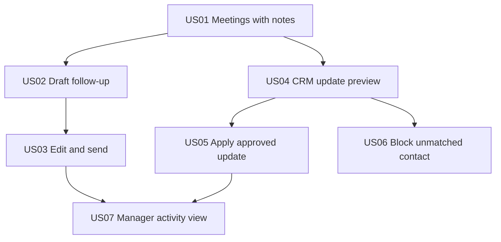

# Decomposition: Acme Field Sales Assistant

> Fictional example. Input: `prd.md` in this folder; appetite from `frame.md`. Method: `skills/decompose-spec`. Approved 2026-03-05.

## Dependency graph

Foundation first: US01. Highest risk first within what the foundation allows: US04 and US05 carry the CRM write, so they start as soon as US01 is done, not after the email path.

## Slices

Layers: **C** collect, **D** decide, **P** present, **W** write.

| Id | Title | Layers | Size | Points | Depends on |
|---|---|---|---|---|---|
| US01 | Show today's finished meetings with their notes | C, P | M | 3 | none |
| US02 | Draft a follow-up email from the meeting notes | C, D, P | M | 3 | US01 |
| US03 | Send the follow-up after the rep edits it | P, W | M | 3 | US02 |
| US04 | Show a CRM update preview for a finished meeting | C, D, P | M | 3 | US01 |
| US05 | Apply the CRM update the rep approved | P, W | L | 5 | US04 |
| US06 | Block the update when the contact has no CRM match | D, P | S | 2 | US04 |
| US07 | Show the manager what was sent, applied and ignored | C, P | S | 2 | US03, US05 |

No slice is XL. US05 is L because it combines the CRM write with the approval screen. If its acceptance criterion grows past three bullets, split it into "apply" and "show the result".

Two slices reach the write layer, US03 (email) and US05 (CRM). Both are slices of the autonomy contract: neither is allowed to act without the rep.

## Acceptance and verification per slice

### US01 Show today's finished meetings with their notes

- Acceptance: Given the rep opens the daily list, when meetings ended today, then each appears with its end time, attendees and a note excerpt.
- Verification: Compare the list against the calendar and the notes tool for five reps on real data.

### US02 Draft a follow-up email from the meeting notes

- Acceptance: A draft appears for each meeting with notes, names every fact it used, and uses no fact that is absent from the notes and the CRM.
- Verification: Eval set of 40 meetings, 100 percent pass on "no invented facts".

### US03 Send the follow-up after the rep edits it

- Acceptance: Send runs only after an explicit rep action, uses the rep's mailbox, and records the sent email id.
- Verification: Probe that calls send without the rep action and expects refusal, plus a real send checked in the mailbox.

### US04 Show a CRM update preview for a finished meeting

- Acceptance: The preview lists each field to change with its old and new value and shows where each new value comes from.
- Verification: Check five previews field by field against the CRM and the notes.

### US05 Apply the CRM update the rep approved

- Acceptance: Apply runs only after approval, re-reads the CRM before writing, and stops if the record changed since the preview.
- Verification: Probe for apply without approval, plus a changed-record test that expects a stop.

### US06 Block the update when the contact has no CRM match

- Acceptance: With no matching contact on the deal, no preview is offered and the rep sees the reason.
- Verification: Test with a contact that exists in the calendar but not on the deal.

### US07 Show the manager what was sent, applied and ignored

- Acceptance: For a chosen week, the manager sees per rep the count of sent, applied and ignored suggestions.
- Verification: Reconcile the counts with the trail for one week of test data.

## Checkpoints

### Checkpoint after US01, US02 and US04

- [ ] The verification of each slice passes
- [ ] A rep sees a draft and a CRM preview for a real meeting
- [ ] The product manager saw it and approved before US03 and US05 started

### Checkpoint after US03, US05 and US06

- [ ] No send and no CRM write is possible without approval
- [ ] The success criterion measurement runs on the trail
- [ ] The product manager approved before US07 started

## Time

| Item type | Closed items in history | p50 | p80 | Label |
|---|---|---|---|---|
| Story, size M | 3 | not computed | not computed | declared |

Acme has no tracker history yet, so every duration in `execution-plan.md` is declared by the engineering lead and labeled `declared`. After eight closed stories of a size, replace the declared number with p50 for planning and p80 for commitment.

Appetite check: the frame allows six weeks of two people. The declared critical path is 13 working days, which leaves room inside the appetite for the checkpoints, the pilot, and the margin that declared numbers usually need.

## Index of cards

| Slice | Card |
|---|---|
| US01 to US07 | Created in the tracker from `execution-plan.md` on 2026-03-09. The ids live there, not in this file. The mapping from slice ids to tracker codes is in this folder's `README.md`. |
