# Execution plan: Acme Field Sales Assistant, follow-up after customer meetings

> Fictional example. Version 1 | Sources: `prd.md`, `decomposition.md` | Start date: Monday, day 1 of the plan

## 1. Summary

**In 30 seconds.** Reps first see their finished meetings with drafted follow-ups and a CRM update preview. Then they send and apply them with their own approval. The manager gets a weekly view last.

| Metric | Value |
|---|---|
| Epics | 1 |
| Features | 4 |
| Stories | 7 |
| Total effort (days, declared) | 21 |
| Critical path (days) | 13 |
| Phases | 3 |

Pending decisions: see chapter 8.

## 2. Delivery phases

### Phase 1: See and draft (days 1 to 6)

- What goes live: the rep opens a daily list of finished meetings, reads a drafted follow-up and sees a CRM update preview. Nothing is sent and nothing is written.
- Why first: it proves the data and the draft quality with no customer risk.
- Stories: US01, US02, US04.
- Exit gate: a rep sees a draft and a preview for a real meeting, and the evals for "no invented facts" pass.
- Decisions this phase needs: D1 (transcripts).

### Phase 2: Send and write back (days 7 to 11)

- What goes live: the rep edits and sends the follow-up from their mailbox, and approves a CRM update that is then applied.
- Why second: these are the two actions that touch the outside world, so they come after the drafts are trusted.
- Stories: US03, US05, US06.
- Exit gate: probes confirm no send and no CRM write without approval, and the success measurement runs on the trail.
- Decisions this phase needs: D2 (read receipts).

### Phase 3: Manager view (days 12 to 13)

- What goes live: the sales manager sees sent, applied and ignored counts per rep per week.
- Why last: it reads the trail that phases 1 and 2 produce.
- Stories: US07.
- Exit gate: counts reconcile with the trail for one week of test data.
- Decisions this phase needs: D3 (trail retention).

### Weekly cadence

| Week | Demonstrable | Stories done |
|---|---|---|
| 1 (days 1 to 5) | The daily list of finished meetings with notes | US01 |
| 2 (days 6 to 10) | Drafts and CRM previews for real meetings, the rep sends a follow-up | US02, US04, US03 |
| 3 (days 11 to 13) | Approving a preview writes to the CRM, and the manager sees the week | US05, US06, US07 |

## 3. Schedule

Two parallel tracks, working days. All durations are declared by the engineering lead (see `decomposition.md`).

| Story | Size | Days | Depends on | Track | Start | End |
|---|---|---|---|---|---|---|
| US01 | M | 3 | none | A | 1 | 3 |
| US02 | M | 3 | US01 | A | 4 | 6 |
| US04 | M | 3 | US01 | B | 4 | 6 |
| US03 | M | 3 | US02 | A | 7 | 9 |
| US05 | L | 5 | US04 | B | 7 | 11 |
| US06 | S | 2 | US04 | A | 10 | 11 |
| US07 | S | 2 | US03, US05 | A | 12 | 13 |

Critical path: US01, US04, US05, US07, which is 3 + 3 + 5 + 2 = 13 days. Total effort 21 days over two tracks.

```mermaid
gantt
    dateFormat  X
    axisFormat  %s
    section Track A
    US01 :a1, 0, 3
    US02 :a2, 3, 3
    US03 :a3, 6, 3
    US06 :a4, 9, 2
    US07 :a5, 11, 2
    section Track B
    US04 :b1, 3, 3
    US05 :b2, 6, 5
```

Assumptions: two developers, five working days per week, checkpoints happen inside the stories' last day, no holidays counted.

## 4. Items by epic

### Epic 1: Follow-up after customer meetings

**Plain summary:** After a customer meeting, the rep reviews a drafted follow-up and a proposed CRM update instead of writing both from scratch.

- Why: Late follow-ups are the most common reason deals go quiet, and reps lose time writing the same email and CRM note after every meeting.
- Goal: Reps send a reviewed follow-up quickly, and the CRM stays current without manual entry.
- Metrics: share of follow-ups sent within 2 hours of the meeting end; share of finished meetings with a current CRM update; share of drafts the rep sends without rewriting the facts.
- In scope: finished meeting list, draft, send, CRM preview, CRM apply, manager view.
- Out of scope: customer success meetings, scheduling the next meeting, editing another rep's records.
- Risks: Risk: drafts contain unsourced facts. Mitigation: eval set with a 100 percent pass mark before phase 1 exit. Risk: the CRM changes between preview and apply. Mitigation: re-read before write and stop on change. Risk: reps ignore the list. Mitigation: show it as the first screen they open.

#### Feature 1.1: Meetings and notes

**Plain summary:** The rep sees which meetings just ended and what was noted in each.

- Behavior: list finished meetings of the day; show end time and attendees; show a note excerpt; refresh on open.
- Acceptance: a finished meeting appears within 5 minutes of its end; a meeting with no notes is marked as such.

##### US01: Show today's finished meetings with their notes

**Plain summary:** Each morning and after each meeting, the rep sees what happened in their meetings without opening three tools.

- Statement: As an account executive, I want to see my finished meetings with their notes so that I can review them in one place.
- Why it exists: Without this list the assistant has nothing to draft from, and the rep keeps switching tools.
- Demo: The rep opens the list and sees today's meetings with notes.
- Acceptance: each finished meeting appears with end time, attendees and note excerpt; a meeting without notes is flagged; only the rep's own meetings appear.
- Exceptions: calendar unreachable, show the last good list with its timestamp.
- Dependencies: none.
- Traceability: spec, capability meeting-intake.
- Size / days: M, 3.

#### Feature 1.2: Follow-up draft and send

**Plain summary:** The rep gets a drafted follow-up, edits it and sends it from their own mailbox.

- Behavior: draft from notes; show the facts used; edit; send from the rep's mailbox.
- Acceptance: no fact outside the notes and the CRM; send only after an explicit rep action.

##### US02: Draft a follow-up email from the meeting notes

**Plain summary:** After a meeting, the rep finds a ready draft of the follow-up email with the facts it used listed beside it.

- Statement: As an account executive, I want a drafted follow-up so that I review instead of write.
- Why it exists: The draft is the main time saving, and listing the facts is how the rep trusts it.
- Demo: Open a finished meeting and read its draft with the sources shown.
- Acceptance: a draft exists for each meeting with notes; each fact is listed with its source; no fact has no source.
- Exceptions: notes too short, show a message instead of a draft.
- Dependencies: US01.
- Traceability: spec, capability follow-up-draft.
- Size / days: M, 3.

##### US03: Send the follow-up after the rep edits it

**Plain summary:** The rep edits the draft and sends it, and nothing is ever sent without that action.

- Statement: As an account executive, I want to send the follow-up from my own mailbox so that the customer hears from me.
- Why it exists: This is the one action that reaches the customer, so it is the autonomy boundary that matters most.
- Demo: Edit a draft, send it, and see it in the sent folder.
- Acceptance: send runs only after an explicit rep action; the email leaves the rep's mailbox; the sent email id is stored in the trail.
- Exceptions: mailbox error, keep the draft and show the error.
- Dependencies: US02.
- Traceability: spec, autonomy boundary "Ask first: send an email".
- Size / days: M, 3.

#### Feature 1.3: CRM write-back

**Plain summary:** The assistant proposes the CRM update, shows it, and applies it only when the rep approves.

- Behavior: build a preview; show old and new values with sources; apply after approval; stop if the record changed.
- Acceptance: no write without approval; every write re-reads the record first.

##### US04: Show a CRM update preview for a finished meeting

**Plain summary:** After a meeting, the rep sees exactly which CRM fields would change and why.

- Statement: As an account executive, I want a CRM update preview so that I can approve changes quickly.
- Why it exists: The preview is what makes a write safe, and without it reps would not allow writes.
- Demo: Open a finished meeting and see each field with old and new values.
- Acceptance: each field shows old value, new value and source; nothing is written.
- Exceptions: record locked, show a message.
- Dependencies: US01.
- Traceability: spec, capability crm-writeback.
- Size / days: M, 3.

##### US05: Apply the CRM update the rep approved

**Plain summary:** When the rep approves a preview, the CRM is updated, and if the record changed in the meantime the update stops.

- Statement: As an account executive, I want my approved update applied so that I do not retype it.
- Why it exists: This closes the loop and proves the autonomy contract holds when the system writes.
- Demo: Approve a preview and see the CRM change.
- Acceptance: apply runs only after approval; the record is re-read before the write; the apply stops if the record changed since the preview; the result is recorded in the trail.
- Exceptions: CRM unavailable, keep the preview and retry later.
- Dependencies: US04.
- Traceability: spec, autonomy boundary "Ask first: write any field to the CRM".
- Size / days: L, 5.

##### US06: Block the update when the contact has no CRM match

**Plain summary:** If a meeting attendee is not a contact on the deal, the assistant does not propose an update and says why.

- Statement: As an account executive, I want the assistant to refuse unmatched contacts so that it never changes the wrong record.
- Why it exists: Writing to the wrong deal is the failure reps fear most.
- Demo: Open a meeting with an unknown attendee and see the reason shown.
- Acceptance: with no matching contact on the deal, no preview is offered; the reason is shown.
- Exceptions: more than one possible match, ask the rep to choose.
- Dependencies: US04.
- Traceability: spec, autonomy boundary "Never: contact anyone who is not already a contact on the deal".
- Size / days: S, 2.

#### Feature 1.4: Activity trail

**Plain summary:** The manager sees what the assistant suggested and what the reps did with it.

##### US07: Show the manager what was sent, applied and ignored

**Plain summary:** The sales manager sees per rep, per week, how many suggestions were sent, applied or ignored.

- Statement: As a sales manager, I want a weekly activity view so that I can coach follow-up habits.
- Why it exists: It is the measurement of the success criterion and the source for coaching.
- Demo: Pick a week and see counts per rep.
- Acceptance: counts per rep for sent, applied and ignored; counts reconcile with the trail.
- Exceptions: a week with no data shows zero, not an error.
- Dependencies: US03, US05.
- Traceability: spec, capability activity-trail.
- Size / days: S, 2.

## 5. What already exists

| Material | What it saves |
|---|---|
| Calendar API access for reps | No new integration work for US01 |
| CRM sandbox | Safe testing of US04, US05, US06 |

## 6. Where it appears

| Touchpoint | Who sees it | Channel | Built by this backlog? | Depends on another team? |
|---|---|---|---|---|
| Daily list and drafts | Account executive | Web screen | Yes | No |
| Sent follow-up | Customer | Rep mailbox | Send action only | Mail admin must allow send as the rep |
| Weekly activity view | Sales manager | Web screen | Yes | No |

## 7. Glossary

| Term | Definition | Appears in |
|---|---|---|
| CRM | The system where deals and contacts are recorded | all |
| Draft | An email written by the assistant that the rep has not sent | US02, US03 |
| Preview | A list of CRM changes shown before anything is written | US04, US05 |
| Trail | The record of what was suggested, sent, applied and ignored | US07 |
| Critical path | The longest chain of dependent stories, which sets the minimum duration | chapter 3 |
| Checkpoint | A review after a group of stories before the next group starts | chapter 2 |
| Autonomy boundary | A written limit on what the assistant may do without asking | spec, US03, US05 |

## 8. Open items

### Cross-cutting decisions

| Id | Decision | Who answers | Needed by |
|---|---|---|---|
| D1 | Can the assistant read transcripts as well as typed notes? | Sales operations | Phase 1 exit |
| D2 | Is a read receipt acceptable on follow-ups? | Sales manager | Phase 2 |
| D3 | How long is the trail kept? | Legal | Phase 3 |

### Findings from the artifact check

| Id | Finding | Where it appeared | Effect on the plan |
|---|---|---|---|
| A1 | The CRM has two fields for deal value, and the spec names only one | CRM sandbox, field list | US02 and US04 must read the field the spec names. Confirm with sales operations before US02 starts |
| A2 | The notes tool returns notes up to 10 minutes after a meeting ends | Notes tool test | The "appears within 5 minutes" criterion in Feature 1.1 changes to "within 15 minutes" unless the notes tool is faster in production |

### Already decided

- The email is sent from the rep's own mailbox.
- Customer success meetings are out of this slice.

## 9. In the tracker

Order of creation: the epic, then Features 1.1 to 1.4, then US01 to US07, then dependency links, then iteration assignment by phase.

## Gates run before sharing

- [x] Story days per epic match the epic budget (3 + 3 + 3 + 3 + 5 + 2 + 2 = 21)
- [x] Story ids sequential from US01 to US07
- [x] Every story has a phase (US01, US02, US04 in 1; US03, US05, US06 in 2; US07 in 3)
- [x] No dependency points to a later phase, an unknown id, or a cycle
- [x] Every term used is in the glossary
- [x] Every item has a plain summary
