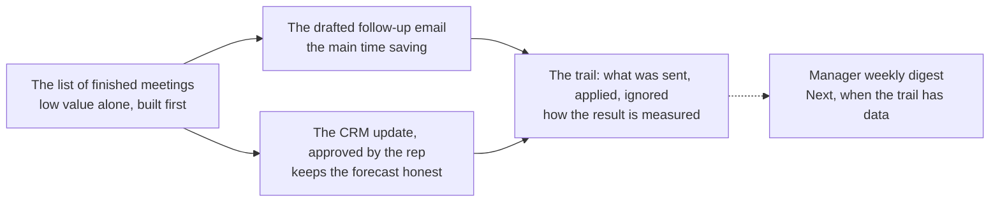

# Now / Next / Later board: ACME-E01 Customer follow-up within a day of every meeting

> Fictional example. Version 1.0 approved 2026-03-05 with the decomposition; review log through 2026-04-13. Epic number: meetings followed up within one working day, 80 percent target (baseline measured in the first two weeks of the pilot). Appetite: six weeks of two people. Method: `skills/prioritize-now-next-later`. Every number is illustrative.

## 1. Board

ROI impact = (Impact × Reach × Confidence) ÷ Effort. Impact is scored against the Epic's number. Effort is the sum of the Feature's story points, set by the developers.

| Feature | Impact | Reach | Conf. | Effort | ROI | Band | Inherited from | Why here |
|---|---|---|---|---|---|---|---|---|
| F01 Meetings and notes | 1 | 1.0 | 3 | 3 | 1.00 | Now | enabling F02 and F03 | Nothing drafts and nothing previews without the list of finished meetings. Lowest value on its own, built first |
| F02 Follow-up draft and send | 3 | 0.9 | 2 | 11 | 0.49 | Now | | The reason the Epic exists: the draft is the main time saving |
| F03 CRM write-back | 3 | 0.9 | 2 | 15 | 0.36 | Now | | Moves the second metric directly; the write path is the autonomy contract |
| F04 Activity trail | 2 | 0.2 | 3 | 2 | 0.60 | Now | | Measures the Epic's number; without it nobody can read the result |
| F05 Manager weekly digest | 2 | 0.2 | 1 | 8 | 0.05 | Next | | Added 2026-04-13 from pilot feedback; valuable once F04 has two weeks of data; scoped, not estimated to the story |
| F06 Drafts in a second language | 1 | 0.1 | 1 | 8 | 0.01 | Later | | One in ten reps works in a second language; decision on language detection due 2026-04-20 |
| F07 Schedule the next meeting from the follow-up | no score | | | no stories | | to refine | | Out of first-release scope in the Epic; nobody has cut it, so it is not ranked |

The ROI score on its own would put F01 fourth and F04 third. The chain puts F01 first.

## 2. The enabling chain

| Feature | Depends on | Enables |
|---|---|---|
| F01 Meetings and notes | none | F02, F03 |
| F02 Follow-up draft and send | F01 | F04 |
| F03 CRM write-back | F01 | F04 |
| F04 Activity trail | F02, F03 | F05 |
| F05 Manager weekly digest | F04 | |
| F06 Drafts in a second language | F02 | |

*Read it from the right: the value sits in the draft and the CRM update. Neither exists without the meeting list, so the meeting list goes first.*

Go-live set (wave 1): F01, then F02 and F03 in parallel, then F04. Inside F03 the single write path (ACME-E01-F03-US01, an Enabler) starts on day 1 because nothing depends on it and everything in F03 depends on it.

## 3. Waves

| Wave | Features, in order | Ends with | Validation | Reserve for enabling work |
|---|---|---|---|---|
| 1 | F01, F02 and F03 in parallel, F04 | A rep sends a reviewed follow-up and approves a CRM update; the manager sees the week | Pilot with 12 reps from 2026-03-30 | One third of each sprint: the two Enablers (ACME-E01-F02-US04, ACME-E01-F03-US01) are allocated first |
| 2 | F05 | The manager gets a weekly digest without opening the trail | Two managers read it for two weeks | One third |

## 4. Weekly demonstrables

| Week | Dates (2026) | What a person can see or use |
|---|---|---|
| 1 | 03-09 to 03-13 | The list of today's finished meetings with their notes. The CRM write path exists and is tested against the sandbox |
| 2 | 03-16 to 03-20 | A drafted follow-up with the facts it used; a CRM update preview with old and new values; a draft stored until the rep decides |
| 3 | 03-23 to 03-27 | A rep sends a follow-up from their own mailbox; an approved preview writes to the CRM and stops if the record changed; the manager sees sent, applied and ignored for the week |
| 4 | 03-30 to 04-03 | Pilot: twelve reps use it on real meetings; the first baseline reads |
| 5 | 04-06 to 04-10 | The draft that showed twice the CRM value is reproduced as eval case E03 before the fix (BUG03) |
| 6 | 04-13 to 04-17 | Snapshot w16, sponsor review, roadmap photo; F05 enters Next |
| 7 | 04-20 to 04-24 | Send and write-back pass the phase 2 gate on the full eval set; language decision taken for F06 |
| 8 | 04-27 to 05-01 | Phase 2 go-live: send and write-back on for the pilot group |

## 5. Review log

| Date | Item | From | To | Reason |
|---|---|---|---|---|
| 2026-03-05 | F01 | scored fourth by ROI | Now, first in wave 1 | Inherited priority: F02 and F03 cannot start without it |
| 2026-03-05 | F07 | candidate | to refine | No stories; the Epic lists "scheduling the next meeting" as out of scope |
| 2026-04-13 | F05 | not on the board | Next | Three of twelve pilot managers asked for a weekly digest; scoped, to be estimated when F04 has two weeks of data |
| 2026-04-13 | Phase 2 go-live | 04-21 | 04-28 | BUG03 fix and the eval re-run took the week; recorded as a delay event in `roadmap-status.md` |

Removed this week (w16): "Attach the proposal PDF to the draft" (a candidate from feedback). Reason: attachments are out of the first-release scope in F02, and only one rep asked.

## Gates before sharing

- [x] Every scored Feature has estimated stories (F05 is scored for ordering only and sits in Next, not Now)
- [x] Every Now Feature's prerequisites are in Now with inherited priority written
- [x] No later-band dependency, no cycle, no implied edge (F04 to F01 is implied through F02 and F03, so it is not drawn)
- [x] Wave 1 is the go-live set, in dependency order
- [x] Every week has a demonstrable
- [x] No date typed on this board; the dates in chapter 4 are derived from the capacity plan

