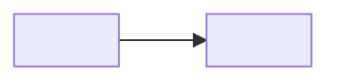

# Now / Next / Later board: <Epic>

Version: <n> | Date: <date of this board> | Epic number: <the metric and its target> | Appetite: <from the frame> | Source: decomposition v<n>

## 1. Board

ROI impact = (Impact × Reach × Confidence) ÷ Effort. Impact is scored against the Epic's number only. A Feature without estimated stories has no score and sits in "to refine".

| Feature | Impact (1 to 3) | Reach (0 to 1) | Confidence (1 to 3) | Effort (points) | ROI | Band | Inherited from | Why here |
|---|---|---|---|---|---|---|---|---|
| <code> <name> | | | | | | Now / Next / Later / to refine | <Feature it enables, or none> | <one line> |

## 2. The enabling chain

Relations only. No dependency points to a later band or wave. No cycle. Implied edges removed.

| Feature | Depends on | Enables |
|---|---|---|
| | | |

Go-live set (wave 1): <the smallest set of Features that makes the first valuable outcome usable in production, in dependency order>

## 3. Waves

| Wave | Features, in order | Ends with | Validation | Reserve for enabling work |
|---|---|---|---|---|
| 1 | | <something a person uses> | <short validation with real users> | <share> |
| 2 | | | | |

## 4. Weekly demonstrables

| Week | What a person can see or use |
|---|---|
| 1 | |
| 2 | |
| 3 | |

An empty week means the slicing is wrong. Send it back to the decomposition.

## 5. Review log

One line per move, with its reason. Items move only here.

| Date | Item | From | To | Reason |
|---|---|---|---|---|
| | | | | |

Removed this week: <items and reasons, or "none">

## Gates before sharing

- [ ] Every scored Feature has estimated stories
- [ ] Every Now Feature's prerequisites are in Now with inherited priority written
- [ ] No later-band dependency, no cycle, no implied edge
- [ ] Wave 1 is the go-live set, in dependency order
- [ ] Every week has a demonstrable
- [ ] No date typed on this board
